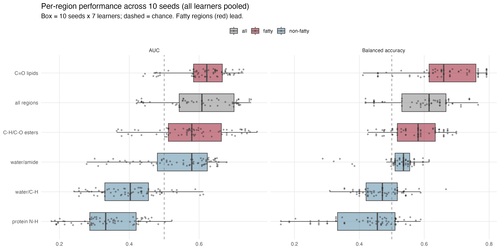
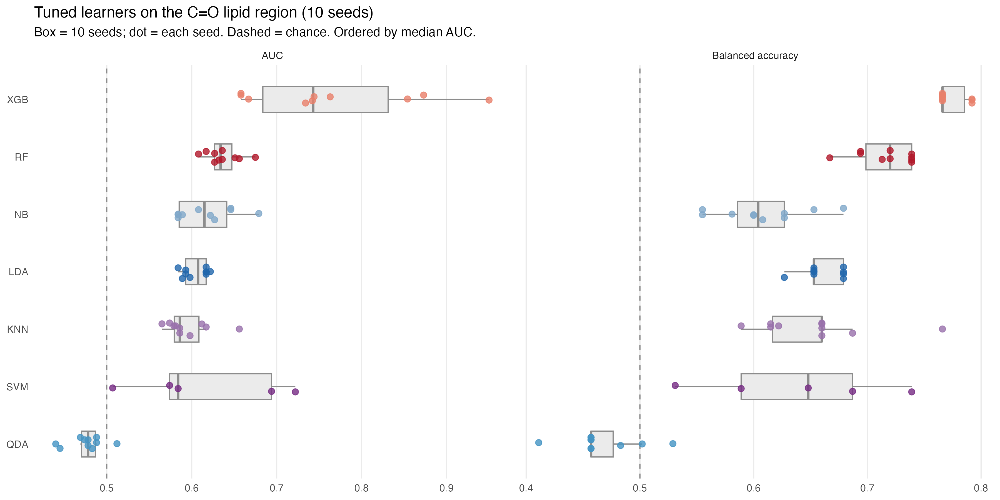

# NIR Spectroscopy for Fish Freshness Classification
## An Honest Exploratory Study — Dimensionality Reduction by Chemical Region

**Author:** Bernardi L.
**Data:** 49 *Sparus aurata* fillets (30 complete-case) | 140 NIR wavelengths (1350–2556 nm) | 10 storage days

---

## Project Overview

This repository contains the revised analytical pipeline for a study evaluating Near-Infrared (NIR) spectroscopy as a non-destructive freshness classification tool for gilthead seabream (*Sparus aurata*) fillets. The K-value, a ratio of ATP nucleotide degradation products, serves as the biochemical reference index.

This is the **coherent evolution of a first project**. The original analysis worked wavelength-by-wavelength and suffered from high dimensionality: 140 spectral channels against a small sample size produce a sparse, unfavourable setting for any classifier. The present study pursues a single objective — reduce the dimensionality of the spectra through a **chemically interpretable strategy** (aggregating wavelengths into bond-class regions) and test whether the earlier results hold or whether classification improves.

---

## Data Engineering & Pre-processing

### Spectral Pre-processing
Raw NIR spectra (5 positions per fillet, averaged) were processed in two steps:

- **Savitzky-Golay smoothing** (window = 11, polynomial degree = 2, no derivative): reduces high-frequency instrumental noise while preserving spectral shape.
- **Standard Normal Variate (SNV)** normalisation, per sample: removes multiplicative scatter effects due to surface texture and sensor distance, so that detected differences reflect chemical composition rather than physical variation.

Pre-processing was performed at the sample level to preserve inter-sample independence.

### Region Aggregation (the core strategy)
The 140 wavelengths were grouped into **five bond-class regions**, each summarised by **three descriptors** (mean, slope, standard deviation), reducing the spectrum to **15 interpretable features**:

| Region | Range (nm) | Chemistry |
|---|---|---|
| water/C-H | 1350–1450 | O-H / C-H first overtone, water-dominated |
| protein N-H | 1500–1560 | N-H overtone, protein structure |
| C=O lipids | 1630–1760 | C-H first overtone / C=O, lipid oxidation |
| water/amide | 1900–2000 | O-H combination + amide |
| C-H/C-O esters | 2130–2350 | C-H/N-H/O-H combination, esters and lipids |

The three descriptors capture, respectively, the average absorbance level of each window, the local trend of the spectrum across it, and its internal variability. Because pre-processing is smoothing + SNV (not derivatives), these descriptors retain a direct physical reading: level, profile shape, and peak structure of each chemical window.

### Missing Data
The chemical components required to compute the K-value (IMP, ATP, ADP, AMP, inosine, hypoxanthine) were missing for 19/49 fillets. This study works **only on the complete-case dataset (n = 30)**; no imputation was performed. This removes the additional variability that imputation would introduce and ensures that spectra and K-value labels derive from the same fully measured samples, at the cost of a smaller sample. Fresh/spoiled labels use the literature threshold **K ≤ 0.40**.

---

## Statistical Analysis

### Classification Framework
Seven supervised classifiers were evaluated: **Naïve Bayes, LDA, QDA, k-NN, SVM, Random Forest, XGBoost**.

The validation protocol is designed to minimise leakage and to give an honest, structure-aware estimate of generalisation:

- **Leave-one-day-out (LODO)** outer validation: an entire storage day is held out at a time, so the model is always tested on an unseen day. Storage day is used only as a grouping variable, never as a feature.
- **Pooled AUC**: predictions are pooled across held-out days before scoring, because per-day AUC is undefined when a day is single-class.
- **Minority oversampling** within the training folds only.
- **Multi-seed repetition** (10 seeds): the whole protocol is repeated across seeds to separate genuine signal from lucky train/test splits.

No supervised in-fold wavelength selection is used: the fixed, a-priori region aggregation replaces it, avoiding both the fragility and the selection-leakage of choosing features from the labels.

### Two-stage design
1. **Exploratory (untuned, all regions):** every region (3 features) and the full 15-feature set are evaluated with all learners, to locate the signal-bearing region.
2. **Confirmatory (tuned, optimal region):** all learners — including SVM (cost, gamma) and k-NN (k) — are tuned on the identified region. Tuning is performed within LODO, inner 3-fold CV, 25 random-search evaluations.

### Uncertainty
Two complementary intervals are placed on the AUC of the reference models on the C=O region:
- **DeLong** analytic 95% CI (optimistic: treats fillets as independent, ignoring day grouping).
- **Day-level resampling** (storage days resampled, LODO re-run): respects the grouping, and is the more honest, slightly conservative estimate.

---

## Results

### Per-region classification (averaged over learners and seeds)

| Region | mean AUC | sd | mean BAcc |
|---|---|---|---|
| **C=O lipids** | **0.615** | 0.070 | 0.659 |
| all regions (15 feat) | 0.601 | 0.102 | 0.596 |
| C-H/C-O esters | 0.581 | 0.103 | 0.573 |
| water/amide | 0.542 | 0.104 | 0.525 |
| water/C-H | 0.401 | 0.088 | 0.466 |
| protein N-H | 0.337 | 0.089 | 0.419 |

The fatty-acid regions (C=O lipids, esters) rank highest; protein and water/C-H fall **below chance**. Using all five regions jointly does **not** beat the single C=O region — the discriminative information is concentrated, not distributed. Values are averaged over all seven learners (including linear models near chance), so they identify the signal-bearing region rather than maximal accuracy.



### Per-learner performance and stability (15 features)

| Learner | mean AUC | sd | run range |
|---|---|---|---|
| XGB | 0.710 | 0.030 | [0.642, 0.778] |
| RF | 0.706 | 0.013 | [0.678, 0.734] |
| NB | 0.613 | 0.057 | [0.484, 0.742] |
| SVM | 0.599 | 0.056 | [0.471, 0.726] |
| k-NN | 0.546 | 0.013 | [0.517, 0.576] |
| LDA | 0.433 | 0.008 | [0.415, 0.452] |

XGBoost and RF lead on mean AUC, but **XGBoost is unstable** across seeds (and its edge vanishes on balanced accuracy, where RF leads). **Random Forest is the reference model**: competitive and stable. Linear models fail → the signal is **non-linear**.



### Hyperparameter tuning (C=O region)
Tuning did **not** improve performance and slightly degraded SVM and RF — expected at this sample size, where the inner selection overfits. **Default-configuration models were retained** as the more robust and parsimonious choice.

### Sampling uncertainty (C=O region)

| Learner | AUC | DeLong 95% CI | Day-resampling 95% CI |
|---|---|---|---|
| RF | 0.646 | [0.383, 0.909] | [0.390, 0.872] |
| XGB | 0.672 | [0.420, 0.925] | [0.421, 0.882] |

The two methods agree closely, confirming the interval width is real. Point estimates indicate a moderate signal (AUC ≈ 0.65), but **the intervals are wide and their lower bounds fall below chance**: at n = 30, chance-level performance cannot be excluded at conventional confidence.

---

## Key Findings

1. **NIR classifies fresh vs spoiled moderately, and only non-linearly.** Tree ensembles reach AUC ≈ 0.71; linear models are at or below chance.
2. **The signal is chemically localised in the fatty-acid regions** (C=O lipids ~1630–1760 nm, esters ~2130–2350 nm), stable across seeds — consistent with lipid oxidation, a process concomitant with ATP degradation, rather than the nitrogenous compounds the K-value measures directly.
3. **Random Forest is the most reliable model**; XGBoost's higher peaks reflect favourable splits, not a reproducible advantage.
4. **Tuning does not help at this sample size**; defaults are more robust.
5. **Sampling uncertainty is large.** The point estimates are encouraging and internally coherent, but the data cannot rule out chance-level performance.

This is a **positive but exploratory result**: it establishes *where* the freshness signal resides and *what kind* of model recovers it. A definitive assessment of NIR's practical value for routine freshness screening will require substantially larger and more balanced datasets.

---

## Repository Structure

```
├── report.Rmd         # Full analysis report (Rmarkdown)
├── settings.R         # Global settings and package loading
├── source_all.R       # Source all custom functions
├── data/
│   ├── raw/           # Original Excel files
│   ├── intermediate/  # Preprocessed data (.rds)
│   └── results/       # Saved model outputs (.rds)
├── code/
│   ├── data.R
│   └── functions.R    # main analysis functions (region aggregation, LODO, multi-seed)
└── plot/              # Generated figures
```

## Software

All analyses performed in **R 4.5.2**.
Key packages: `mlr3`, `mlr3pipelines`, `mlr3tuning`, `ranger`, `xgboost`, `e1071`, `kknn`, `pROC`, `ggplot2`, `data.table`, `checkmate`, `signal`.